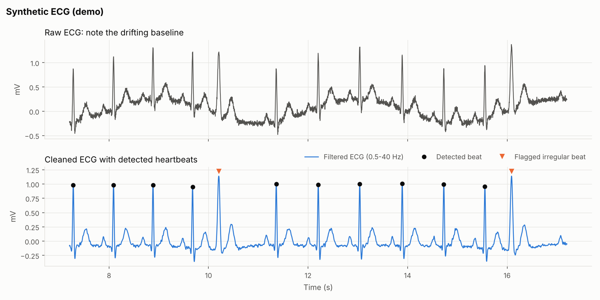
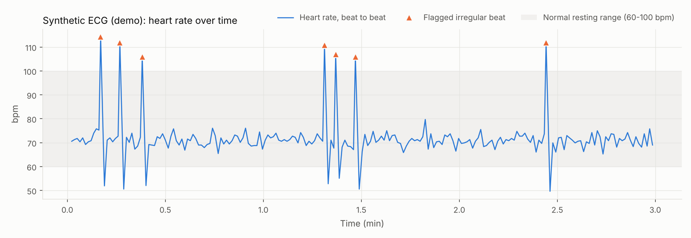

# ECG Heartbeat Detection & Rhythm Analysis

A Python tool that reads real ECG recordings, detects every heartbeat, computes heart rate, flags irregular beats, and measures its own accuracy against beat labels made by cardiologists.

Built on the **MIT-BIH Arrhythmia Database** (PhysioNet), the standard benchmark for heartbeat detection.

> Educational project only. Not a medical device and not for diagnosis.

## Why I built this

I'm a B.E. Computer Science student at SKCET working towards a career in medical technology. ECG monitors, wearables, pacemakers and defibrillators all depend on reliably detecting heartbeats in a noisy signal, so I wanted to understand how that works from the signal up.

## ECG in 30 seconds

Each heartbeat on an ECG has a typical shape:

- **P-wave:** the atria contract
- **QRS complex:** the ventricles contract; the tall, sharp **R-peak** is the easiest landmark to detect
- **T-wave:** the ventricles recover

The time between two R-peaks is the **RR interval**. Heart rate = 60 / RR (in seconds).
A **premature beat** (for example a PVC, premature ventricular contraction) arrives earlier than expected and is usually followed by a longer **compensatory pause**.

## How it works

| Step | What happens | Why |
|---|---|---|
| 1. Load | Read a record and its beat annotations with `wfdb` | Real clinical data, labelled by cardiologists |
| 2. Filter | Band-pass 0.5-40 Hz (zero-phase) | Removes breathing-related baseline wander and high-frequency noise |
| 3. Detect | Simplified **Pan-Tompkins**: 5-15 Hz band-pass, derivative, squaring, 150 ms moving average, adaptive threshold, 200 ms refractory period | The classic real-time QRS detection method used in cardiac monitoring |
| 4. Heart rate | RR intervals, beat-to-beat heart rate, RR variability (SD) | Basic rhythm measures |
| 5. Flag | Premature: RR < 80% of local median. Pause: RR > 150% of local median | Simple rule-based arrhythmia screening |
| 6. Evaluate | Match detections to annotations within ±150 ms; report sensitivity and PPV | Shows how reliable the detector is |

## Run it

```bash
pip install -r requirements.txt

# Real data (downloads from PhysioNet automatically)
python ecg_analysis.py --record 100 --minutes 5     # mostly normal rhythm
python ecg_analysis.py --record 119 --minutes 10    # many PVCs (premature beats)
python ecg_analysis.py --record 208 --minutes 10    # harder: frequent PVCs

# Offline demo with a synthetic ECG (no download needed)
python ecg_analysis.py --synthetic --minutes 3
```

Each run saves to `results/`:
- `*_signal.png`: raw vs. cleaned ECG with detected and flagged beats
- `*_heart_rate.png`: heart rate over time
- `*_report.txt`: heart rate summary and detection accuracy

## Results

<!-- Replace these with your own runs on real records, e.g. record 119 -->

| Record | Beats | Sensitivity | PPV | Premature beats caught |
|---|---|---|---|---|
| Synthetic demo (3 min) | 212 | 100% | 100% | 7 of 7 |
| MIT-BIH 100 | | | | |
| MIT-BIH 119 | | | | |




## What I learned

<!-- Write this section yourself. Interviewers will ask about it. For example:
- what baseline wander is and why filtering matters
- why the refractory period is 200 ms
- why the simple RR rule misses some abnormal beats
-->

## Ideas to extend it

- Classify beats as normal vs. PVC using QRS width and shape, not just timing
- Add HRV measures (RMSSD, pNN50)
- Detect atrial fibrillation from RR irregularity
- Test on all 48 MIT-BIH records and report average accuracy

## References

- Pan J., Tompkins W.J. *A Real-Time QRS Detection Algorithm.* IEEE Transactions on Biomedical Engineering, 1985.
- Moody G.B., Mark R.G. *The impact of the MIT-BIH Arrhythmia Database.* IEEE Engineering in Medicine and Biology, 2001.
- PhysioNet MIT-BIH Arrhythmia Database: https://physionet.org/content/mitdb/
